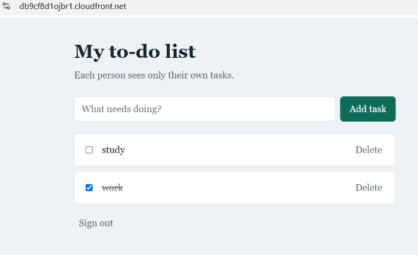
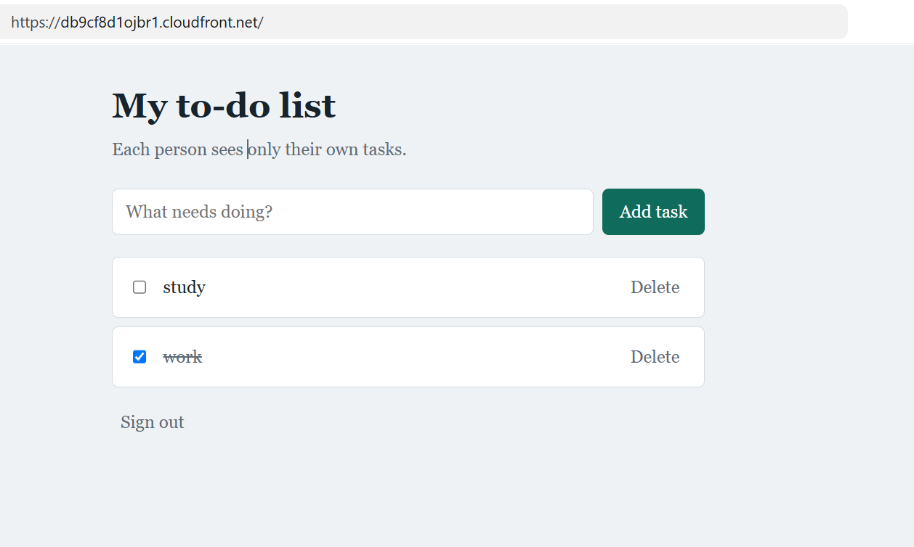
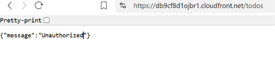
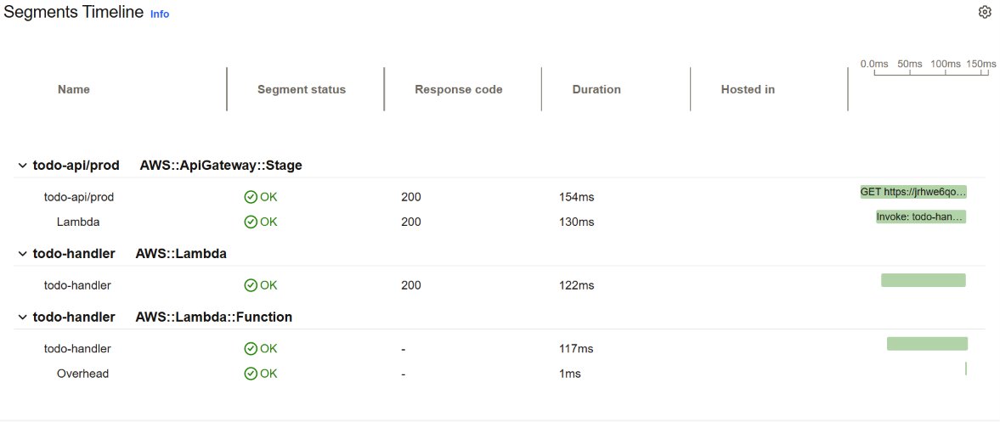
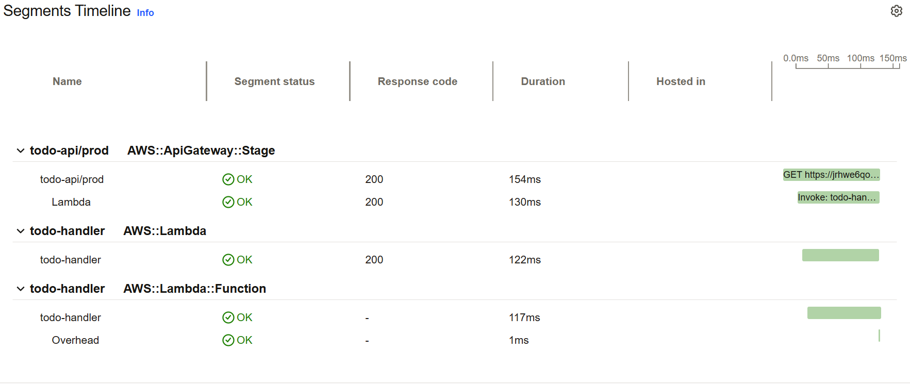
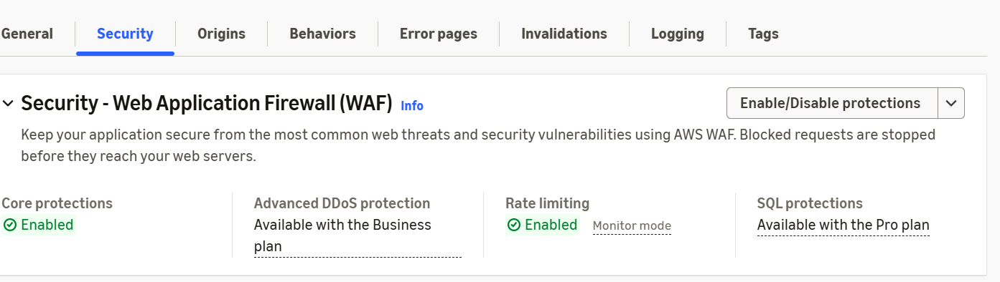
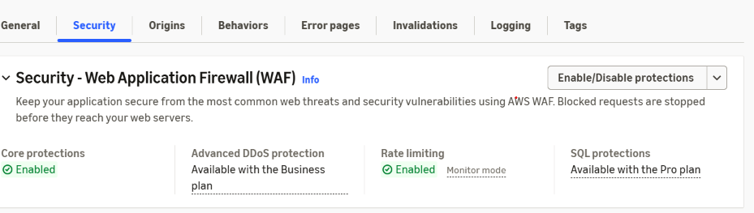

# Serverless To-Do REST API with Cognito Auth, DynamoDB & WAF

**AWS Certified Solutions Architect – Associate · Graduation Project 3 (Serverless)**
Author: **Ayman Surag**

A fully serverless to-do application. Users sign up and sign in with **Amazon Cognito**, and each user can only see and change **their own** tasks. Requests go through a REST API on **API Gateway**, are handled by **AWS Lambda**, and are stored in **DynamoDB**. **CloudFront** serves both the static page (from a private **S3** bucket) and the API from one HTTPS address, **AWS WAF** protections filter traffic at the edge, and **X-Ray** traces requests through API Gateway and Lambda.

**Live demo:** https://db9cf8d1ojbr1.cloudfront.net/ (the resources are deleted after grading to avoid cost; see the screenshots and video instead)

## Contents
1. [Architecture](#1-architecture)
2. [Request flow](#2-request-flow)
3. [AWS services used](#3-aws-services-used)
4. [Design decisions](#4-design-decisions)
5. [API reference](#5-api-reference)
6. [Deployment (console)](#6-deployment-console)
7. [Testing and proof](#7-testing-and-proof)
8. [Security](#8-security)
9. [Cost](#9-cost)
10. [Requirements and what was implemented](#10-requirements-and-what-was-implemented)
11. [Lessons learned and future improvements](#11-lessons-learned-and-future-improvements)
12. [Repository structure](#12-repository-structure)
13. [Clean-up](#13-clean-up)

---

## 1. Architecture


Editable source: [`architecture/diagram.drawio`](architecture/diagram.drawio) (open in [draw.io](https://app.diagrams.net)).

Everything runs in **us-east-1 (N. Virginia)**. There is no VPC: Lambda, API Gateway, DynamoDB and Cognito are managed services that do not need one for this design, and avoiding a VPC also avoids NAT gateway cost.

## 2. Request flow

| # | Step |
|---|---|
| 1 | The user opens the CloudFront address over HTTPS. The default behavior returns `index.html` from the **private S3 bucket** (Origin Access Control). |
| 2 | The user clicks **Sign in**. The **Cognito hosted UI** handles sign-up, e-mail verification and login, then redirects back with an **ID token (JWT)**. |
| 3 | The page calls `/todos` on the **same CloudFront address**, sending the token in the `Authorization` header. |
| 4 | The CloudFront behavior `/todos*` forwards the request to **API Gateway** (origin path `/prod`). Caching is disabled for this behavior and the `Authorization` header is forwarded. |
| 5 | API Gateway's **Cognito authorizer** validates the token. A missing or invalid token returns `401 Unauthorized` and Lambda is never invoked. |
| 6 | API Gateway invokes **Lambda** (proxy integration). The function reads the user ID from the verified `sub` claim. |
| 7 | Lambda runs `Query`, `PutItem`, `UpdateItem` or `DeleteItem` on **DynamoDB**, always scoped to `userId = sub`. |
| – | **WAF protections** on CloudFront filter traffic first, and **X-Ray** records the API Gateway and Lambda segments. |

## 3. AWS services used

| Service | What it does here |
|---|---|
| **S3** | Private bucket holding `index.html`, readable only by CloudFront through a bucket policy |
| **CloudFront** | One HTTPS address for the page and the API; two origins (S3 and API Gateway); default root object `index.html` |
| **AWS WAF** | CloudFront security protections: core protections enabled, rate limiting enabled in monitor mode |
| **API Gateway (REST)** | `todo-api`, stage `prod`; Cognito authorizer on every method; X-Ray tracing on |
| **Cognito** | User pool with e-mail sign-up, hosted UI, and a public single-page-app client (no secret) |
| **Lambda (Python 3.12)** | `todo-handler`: one function handling create, read, update and delete; active X-Ray tracing |
| **DynamoDB** | `Todos` table, on-demand capacity, partition key `userId`, sort key `todoId` |
| **IAM** | `todo-lambda-role`: least privilege, only the DynamoDB actions the code uses |
| **X-Ray** | Traces API Gateway and Lambda requests |

## 4. Design decisions

### DynamoDB data model
| Attribute | Type | Role |
|---|---|---|
| `userId` | String | **Partition key**: the Cognito `sub` |
| `todoId` | String | **Sort key**: a UUID created by Lambda |
| `title` | String | Task text |
| `status` | String | `open` or `done` |

- **Access pattern:** "list my tasks" is a single `Query` on `userId`. The application never uses `Scan`.
- **User isolation:** `userId` comes from the verified token, not from the request body, and is part of every key. A user cannot read or change another user's item by guessing a `todoId`.
- **On-demand capacity:** traffic is low and spiky, so there is nothing to size and nothing to pay while idle.

### Authentication
- Cognito hosted UI with a **public app client** (no client secret, since a browser page cannot keep one private).
- API Gateway's built-in Cognito authorizer checks the token **before** Lambda runs, so unauthenticated traffic costs no Lambda invocations.
- Lambda trusts only `requestContext.authorizer.claims.sub`.

### One domain for the page and the API
Routing `/todos*` through the same CloudFront distribution means:
- the browser makes **same-origin** calls, so CORS is not needed for the CloudFront address;
- **one WAF** protects both the site and the API;
- HTTPS terminates at the nearest edge location.

### CloudFront behavior for the API
| Setting | Value | Why |
|---|---|---|
| Path pattern | `/todos*` | Matches `/todos` and `/todos/{id}` |
| Origin | API Gateway, origin path `/prod` | Maps `/todos` to the `prod` stage |
| Allowed methods | GET, HEAD, OPTIONS, PUT, POST, PATCH, DELETE | The app needs writes |
| Cache policy | CachingDisabled | Responses are per user and must never be shared |
| Origin request policy | AllViewerExceptHostHeader | Forwards the `Authorization` header to API Gateway |

### Least-privilege IAM
The Lambda role allows only `GetItem`, `PutItem`, `UpdateItem`, `DeleteItem` and `Query` on the one `Todos` table, plus CloudWatch Logs and X-Ray write access. No DynamoDB resource-based policy is used because the identity policy is enough inside one account.

## 5. API reference

Base URL: `https://db9cf8d1ojbr1.cloudfront.net`. Every route requires `Authorization: <Cognito ID token>`.

| Method | Path | Body | Success | Errors |
|---|---|---|---|---|
| `GET` | `/todos` | none | `200` array of the user's todos | `401` |
| `POST` | `/todos` | `{"title":"study"}` | `201` the created item | `400` (missing title or invalid JSON), `401` |
| `PUT` | `/todos/{id}` | `{"title":"study","status":"done"}` | `200` `{"updated":"<id>"}` | `400`, `401` |
| `DELETE` | `/todos/{id}` | none | `200` `{"deleted":"<id>"}` | `401` |

Example (replace `TOKEN` with the ID token):
```bash
curl -H "Authorization: TOKEN" https://db9cf8d1ojbr1.cloudfront.net/todos
curl -X POST -H "Authorization: TOKEN" -H "Content-Type: application/json" \
     -d '{"title":"study"}' https://db9cf8d1ojbr1.cloudfront.net/todos
```

## 6. Deployment (console)

1. **DynamoDB:** create table `Todos` (partition key `userId` String, sort key `todoId` String, on-demand capacity).
2. **IAM:** create role `todo-lambda-role` (trusted service: Lambda) with `AWSLambdaBasicExecutionRole`, `AWSXRayDaemonWriteAccess` and an inline policy allowing `GetItem`, `PutItem`, `UpdateItem`, `DeleteItem` and `Query` on the `Todos` table ARN.
3. **Lambda:** create `todo-handler` (Python 3.12) from [`lambda/handler.py`](lambda/handler.py), use the existing role `todo-lambda-role`, set environment variable `TABLE_NAME=Todos`, and turn on **Lambda service traces**.
4. **Cognito:** create a user pool with e-mail sign-in and a **single-page application** app client. Add a hosted UI domain, scopes `openid` and `email`, and the callback and sign-out URLs for the CloudFront address.
5. **API Gateway:** create REST API `todo-api` with `/todos` (GET, POST) and `/todos/{id}` (PUT, DELETE). Use Lambda proxy integration, add a **Cognito authorizer** on every method, enable CORS, deploy to stage `prod`, and enable **X-Ray tracing** on the stage.
6. **S3:** create a private bucket (Block Public Access on) and upload [`frontend/index.html`](frontend/index.html) after filling in `cognitoDomain`, `clientId` and `apiUrl`.
7. **CloudFront:** create a distribution with the S3 origin (Origin Access Control, bucket policy applied) and a second origin for API Gateway with origin path `/prod`. Add the `/todos*` behavior from section 4 and set the default root object to `index.html`.
8. **WAF:** on the distribution's **Security** tab, keep the core protections on and enable **rate limiting**.
9. Update the page's `apiUrl` to the CloudFront address, re-upload `index.html`, and create a CloudFront invalidation for `/*`.

## 7. Testing and proof

| Check | Expected | Result |
|---|---|---|
| `GET /todos` without a token | `401 Unauthorized` from the authorizer | Pass (screenshot 08) |
| Sign up, sign in, add, tick, reload and delete tasks | UI updates and data persists | Pass (screenshots 03, 09) |
| Items stored per user | Rows keyed by the user's `sub` | Pass (screenshot 04) |
| Requests traced | API Gateway to Lambda segments | Pass (screenshots 12, 13) |
| WAF protections on CloudFront | Core protections and rate limiting enabled | Pass (screenshots 10, 11) |

### Screenshots

**The app running on the CloudFront address**


**The working to-do list**


**Calling the API without a token is rejected by the Cognito authorizer**


**Items in the `Todos` table, keyed by the user's Cognito `sub`**


**X-Ray segment timeline: API Gateway (154 ms), Lambda (130 ms), `todo-handler` (117 ms)**


**X-Ray traces: GET, POST, PUT and DELETE requests, all OK**


**CloudFront WAF core protections enabled**


**CloudFront WAF rate limiting enabled (monitor mode)**


## 8. Security

- **Defense in depth:** WAF protections at the edge, then the JWT authorizer, then per-user key scoping in Lambda.
- **Least privilege:** the Lambda role can only run five DynamoDB actions on one table.
- **Private storage:** S3 Block Public Access is on, and only this CloudFront distribution can read the bucket.
- **Encryption:** HTTPS from the viewer to CloudFront and from CloudFront to API Gateway; DynamoDB and S3 use encryption at rest by default.
- **Frontend:** task text is displayed with `textContent` (no HTML injection), and the token is kept in `sessionStorage` rather than a cookie.
- **No secrets in the repository:** the Cognito client ID, domain and API address are public identifiers, not credentials. No AWS access keys are used.

## 9. Cost

The project stays on the AWS free tier at demo scale: Lambda, DynamoDB on-demand, Cognito, API Gateway and X-Ray at low volume, and CloudFront on the **Free plan ($0/month)**, which includes the WAF core protections. A budget alert was set before building. No NAT gateway, VPC endpoint or separate Web ACL was created.

## 10. Requirements and what was implemented

| Requirement from the project brief | Status | Implementation |
|---|---|---|
| REST API with API Gateway, Lambda and DynamoDB | Done | `todo-api`, `todo-handler`, `Todos` |
| Cognito user pool, hosted UI, JWT authorizer | Done | Hosted UI, Cognito authorizer on every method |
| Lambda CRUD, environment variables, IAM role | Done | `TABLE_NAME`, `todo-lambda-role` |
| DynamoDB table design, on-demand capacity | Done | `userId`/`todoId` keys, on-demand |
| DynamoDB GSI and Streams | Not implemented | Only one access pattern was needed |
| WAF rate-based rule and managed rules | Partly done | Core protections on, rate limiting in monitor mode; geo blocking not used |
| CloudFront in front of API Gateway | Done | `/todos*` behavior to the API origin |
| X-Ray distributed tracing | Done for API Gateway and Lambda | DynamoDB calls would need the X-Ray SDK |
| S3 and CloudFront static frontend | Done | Private bucket, one HTML page |
| API Gateway response caching and usage plans | Not implemented | Caching is billed hourly and was left out to stay on the free tier |

## 11. Lessons learned and future improvements

**Lessons learned**
- **A 502 from API Gateway** came from Lambda running under an auto-generated role without DynamoDB permissions. Testing the function directly with a fake event showed the exact `AccessDeniedException`, and switching it to `todo-lambda-role` fixed it.
- **Cognito "Invalid request"** was caused by a callback URL that did not exactly match the redirect (`https` versus `http`).
- **CloudFront in front of API Gateway** needs all HTTP methods allowed, caching disabled, and the `Authorization` header forwarded, otherwise writes fail or every call returns 401.
- **Changes are not live until deployed:** API Gateway needs a new deployment, and CloudFront needs an invalidation after the page is replaced in S3.

**Future improvements**
- Switch WAF rate limiting from monitor mode to blocking after reviewing the metric.
- Use the **authorization code flow with PKCE** instead of the implicit grant.
- Add a condition to the update so it fails for items that do not exist, and validate title length.
- Enable API Gateway caching on `GET /todos` with the `Authorization` header in the cache key.
- Add the X-Ray SDK to Lambda to see DynamoDB segments.
- Add a custom domain (Route 53 and ACM), and define the infrastructure with CloudFormation or Terraform.

## 12. Repository structure
```
.
├── README.md
├── architecture/
│   ├── diagram.drawio
│   └── diagram.png
├── lambda/
│   └── handler.py
├── frontend/
│   └── index.html
└── screenshots/
```

## 13. Clean-up

Delete in this order: CloudFront distribution, API Gateway `todo-api`, Lambda `todo-handler`, Cognito user pool, DynamoDB table `Todos`, S3 bucket (empty it first), and the IAM roles `todo-lambda-role` and the auto-created `todo-handler-role-...`.

---
*Built as the graduation project for the AWS Solutions Architect – Associate track.*
