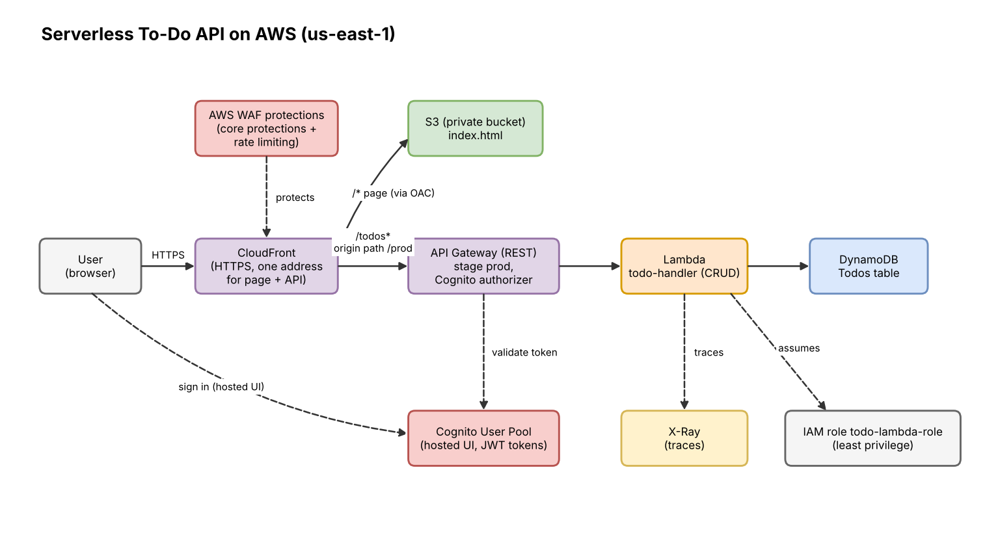

# Serverless To-Do API on AWS

A serverless REST API with user login, built for the AWS Solutions Architect – Associate graduation project (Manara).

**Author:** YOUR NAME
**Live demo / video:** ADD LINK (optional)

## What it does

Users sign up and sign in with Amazon Cognito, then create, read, update and delete their own to-do items through a REST API. Each user only sees their own data. There are no servers to manage, and the project runs almost entirely on the AWS free tier.

## Architecture

> Export `architecture/diagram.drawio` from draw.io as `diagram.png` and keep both files in the repo.

**Request flow**
1. The user opens the site through CloudFront, which serves the static frontend from S3.
2. The user signs in through the Cognito hosted UI and receives a JWT (ID token).
3. The frontend calls `/todos` with the token. The request passes through CloudFront and WAF to API Gateway.
4. API Gateway checks the token with the Cognito authorizer.
5. API Gateway invokes Lambda, which reads or writes DynamoDB.
6. X-Ray traces the whole call chain.

## AWS services and why I used them

| Service | Purpose | Why |
|---|---|---|
| S3 | Hosts the static frontend | Cheap, durable, no server |
| CloudFront | CDN for frontend and API | Lower latency, HTTPS, caching |
| API Gateway | REST API front door | Managed auth, throttling, caching |
| Cognito | User sign-up and login | Managed identity, JWT tokens |
| Lambda | CRUD business logic | Pay per request, scales automatically |
| DynamoDB | Stores to-do items | Serverless, on-demand capacity |
| WAF | Rate limiting and managed rules | Blocks abuse and common attacks |
| X-Ray | Distributed tracing | Find latency across the call chain |
| IAM | Least-privilege roles | Lambda can only touch its own table |

## Design decisions

- **DynamoDB keys:** partition key `userId`, sort key `todoId`. Querying by `userId` returns only that user's items.
- **On-demand capacity:** no capacity planning and no cost when idle.
- **Least privilege:** the Lambda role only allows the needed actions on the `Todos` table.
- **Token auth:** API Gateway rejects requests without a valid Cognito token before Lambda runs.

## Setup steps

1. Create the DynamoDB table `Todos` (on-demand, `userId` + `todoId`).
2. Create the IAM role for Lambda (DynamoDB access on the table, logs, X-Ray).
3. Create the Lambda function from `lambda/handler.py` (Python 3.12, env var `TABLE_NAME=Todos`, X-Ray active tracing on).
4. Create the Cognito User Pool and app client, and set up the hosted UI domain.
5. Create the API Gateway REST API with `/todos` and `/todos/{id}`, add the Cognito authorizer, enable CORS, and deploy to stage `prod`.
6. Update the `CONFIG` values in `frontend/index.html`, then upload it to a private S3 bucket.
7. Create the CloudFront distribution (S3 origin with Origin Access Control, and API Gateway as a second origin).
8. Create a WAF Web ACL with a rate-based rule and the AWS managed Common Rule Set, then attach it.

## Testing and screenshots

Add your screenshots to the `screenshots/` folder and list them here:

- [ ] Cognito sign-up and login
- [ ] API call without a token returns 401
- [ ] API call with a token returns 200
- [ ] Items stored in DynamoDB
- [ ] X-Ray service map
- [ ] WAF blocking or rate limiting a request

## Cost

This project stays within the free tier. WAF and API Gateway caching are not free, so I enabled them only for testing and deleted them afterwards. A budget alert of $1 was set.

## Challenges and lessons learned

Write 3 to 5 short points here (for example CORS errors, token type, IAM permissions).

## Clean up

Delete in this order: WAF Web ACL, CloudFront distribution, API Gateway, Lambda, Cognito User Pool, DynamoDB table, S3 bucket, IAM role.
